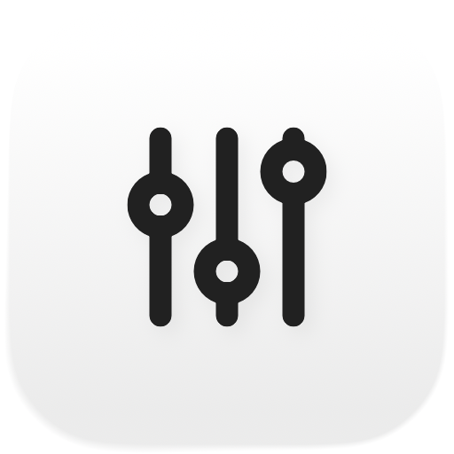

<div align="center">
<picture>
<source media="(prefers-color-scheme: dark)" srcset="Docs/icon-dark.png" />

</picture>
<h1>desktop-commander</h1>
<p><strong>Menu bar switches and window management for macOS.</strong></p>
<p>
<a href="https://github.com/fballiano/desktop-commander/releases/latest"></a>
<a href="https://github.com/fballiano/desktop-commander/releases"></a>

<a href="LICENSE"></a>
</p>
<p><a href="https://github.com/fballiano/desktop-commander/releases/latest"></a></p>
</div>

<table align=center><tr><td align=center>
<strong>If you find my work valuable, please consider sponsoring</strong><br />
<a href="https://github.com/sponsors/fballiano" target=_blank title="Sponsor me on GitHub"></a>
<a href="https://www.buymeacoffee.com/fballiano" target=_blank title="Buy me a coffee"></a>
<a href="https://www.paypal.com/paypalme/fabrizioballiano" target=_blank title="Donate via PayPal"></a>
</td></tr></table>

---

## Features

<table>
<tr><td><b>Eight switches</b></td><td>Keep awake, hide the desktop widgets, hide the desktop icons, show the hidden files, hide the windows, lock the keyboard, start the screen saver, clean the screen.</td></tr>
<tr><td><b>Fifteen window places</b></td><td>Halves, quarters, thirds, two thirds, maximize and centre, each with its own hot key.</td></tr>
<tr><td><b>Two displays</b></td><td>Send the front window to the next display, in the same relative place.</td></tr>
<tr><td><b>Undo</b></td><td>One command puts the last moved window back where it was.</td></tr>
<tr><td><b>No copy of your settings</b></td><td>It writes the settings of the system itself, so a change is the same change you would make in System Settings.</td></tr>
<tr><td><b>Scriptable</b></td><td>AppleScript, Shortcuts and Spotlight drive the same commands.</td></tr>
<tr><td><b>Visible state</b></td><td>The menu bar icon fills while any switch is on.</td></tr>
<tr><td><b>Light and dark</b></td><td>The icon follows the system, in the menu bar and in the Finder.</td></tr>
</table>

## Install

With [Homebrew](https://brew.sh):

```bash
brew tap fballiano/desktop-commander https://github.com/fballiano/desktop-commander
brew trust --cask fballiano/desktop-commander/desktop-commander
brew install --cask desktop-commander
```

The URL is part of the first command, because this repository is the tap itself.
Homebrew 6 refuses to load a cask from a tap outside `Homebrew/*` until you
trust it, so the second command is also necessary.

Or download the DMG from the
[latest release](https://github.com/fballiano/desktop-commander/releases/latest).
Open it and drag **desktop-commander** into **Applications**.

> [!IMPORTANT]
> The application is signed ad hoc, not with an Apple Developer ID, so macOS
> blocks the first launch. Open **System Settings → Privacy & Security** and
> select **Open Anyway**. Homebrew also marks the application, so this step
> applies to both ways to install.
>
> A terminal does the same thing:
>
> ```bash
> xattr -dr com.apple.quarantine /Applications/desktop-commander.app
> open /Applications/desktop-commander.app
> ```

The application has no dock icon. It appears in the menu bar.

| Item | Value |
| --- | --- |
| macOS | 15.0 or later |
| Hardware | Apple silicon and Intel (universal binary) |
| Permissions | Accessibility, for the window commands and the keyboard lock only. Read the next section. |

## The Accessibility permission

Two features need it: **every window command** and **the keyboard lock**. The
other six switches need nothing.

The application never asks at launch. It asks the first time you use a window
command, so if you only want the switches you never see a permission sheet.

> [!WARNING]
> **The permission breaks at every update.** The application is signed ad hoc, so
> its signature changes with every build. macOS ties the permission to that
> signature. After an update, open **System Settings → Privacy & Security →
> Accessibility**, remove **desktop-commander** with the minus button, and add it
> again.
>
> There is no way around this without an Apple Developer ID.

## The menu

| Item | What it does | Permission |
| --- | --- | --- |
| Keep awake | Stops the Mac and the display from sleeping. A submenu sets the length: no end, 15 minutes, 30 minutes, 1 hour, 2 hours, 5 hours. | none |
| Hide the desktop widgets | The same switch as **System Settings → Desktop & Dock → Widgets**. | none |
| Hide the desktop icons | Finder restarts, which macOS does at once. | none |
| Show the hidden files | The files whose name starts with a point. Finder restarts. | none |
| Hide the windows | Hides every ordinary application. Turning it off brings back only the ones it hid. | none |
| Keyboard lock | The keys reach nothing. The mouse still works. | **Accessibility** |
| Screen saver | Starts the screen saver. | none |
| Clean the screen | A black window over every screen. It takes the keys and the mouse, so a cloth presses nothing. Any key ends it. | none |
| Windows ▸ | The fifteen places, the next display, and the undo. | **Accessibility** |

## The window places

| Group | Places |
| --- | --- |
| Halves | Left, right, top, bottom |
| Quarters | Top left, top right, bottom left, bottom right |
| Thirds | Left, centre, right, first two, last two |
| Whole screen | Maximize, centre |

**Move to the next display** keeps the window in the same relative place, so a
window on the right half of one display arrives on the right half of the next
one, whatever the two sizes are.

**Undo the last move** puts the window back where it was. It only works while
that window is still in front, so a window you left is never brought back by
surprise.

The first launch sets three hot keys, and only the first launch:

| Command | Hot key |
| --- | --- |
| Left half | <kbd>⌃</kbd><kbd>⌥</kbd><kbd>⌘</kbd><kbd>←</kbd> |
| Right half | <kbd>⌃</kbd><kbd>⌥</kbd><kbd>⌘</kbd><kbd>→</kbd> |
| Maximize | <kbd>⌃</kbd><kbd>⌥</kbd><kbd>⌘</kbd><kbd>F</kbd> |

Every other command has an empty recorder in **Preferences → Shortcuts**. If you
clear one of the three, it stays cleared.

## The keyboard lock

The lock is for wiping the keys while you keep watching the screen. It has three
ways out, because a keyboard that cannot be unlocked is a broken Mac:

1. <kbd>⌃</kbd><kbd>⌥</kbd><kbd>⌘</kbd><kbd>U</kbd> ends it.
2. A timer ends it. **Preferences → Switches** sets the length, from 10 seconds
   to 10 minutes.
3. <kbd>⌘</kbd><kbd>⌥</kbd><kbd>esc</kbd> is **never** swallowed, so Force Quit
   always works. Ending the application gives the keyboard back at once.

## Settings

Open **Preferences…** from the menu, or press <kbd>⌘</kbd><kbd>,</kbd>.

| Tab | What is in it |
| --- | --- |
| General | Start at login (on by default), notifications, the length of Keep awake. |
| Windows | The gap between a window and the edge of the screen, and the state of the Accessibility permission with a button that opens the pane. |
| Switches | The timer of the keyboard lock. |
| Shortcuts | A recorder for each of the eight switches and each of the seventeen window commands. |

The gap sits once at each edge of the screen and once between two windows that
meet, so two windows side by side leave exactly one gap between them.

## Automation

```applescript
tell application "desktop-commander"
    keep awake
    allow sleep
    hide desktop icons
    show desktop icons
    show hidden files
    hide windows
    start screen saver
    clean screen
    lock keyboard
    arrange window "leftHalf"
    move window to next display
    undo window move
end tell
```

`arrange window` takes the name of a place: `leftHalf`, `rightHalf`,
`topHalf`, `bottomHalf`, `topLeftQuarter`, `topRightQuarter`,
`bottomLeftQuarter`, `bottomRightQuarter`, `leftThird`, `centreThird`,
`rightThird`, `firstTwoThirds`, `lastTwoThirds`, `maximize`, `centre`.

From a terminal:

```bash
osascript -e 'tell application "desktop-commander" to arrange window "rightHalf"'
```

The Shortcuts app lists the same commands under **desktop-commander**, and there
the place is a list you pick from instead of a piece of text. Spotlight runs them
too.

## Where the data lives

| What | Where |
| --- | --- |
| Settings | `~/Library/Preferences/com.fabrizioballiano.desktop-commander.plist` |
| The desktop switches | Not here. They live in `com.apple.finder` and `com.apple.WindowManager`, which are the settings of macOS itself. |

The application keeps no copy of a setting of the system, so a change you make in
System Settings or in Finder is the same change, and neither side falls out of
step.

<details>
<summary><strong>Build from source</strong></summary>

<br />

You need Xcode 26 or later.

```bash
make install     # build the Release app and copy it to /Applications
```

Other targets:

```bash
make build       # build only
make test        # run the unit tests
make run         # build, then launch
make dmg         # build the Release app and pack it into ./dist/*.dmg
make generate    # rebuild DesktopCommander.xcodeproj from project.yml (needs xcodegen)
make uninstall   # remove /Applications/desktop-commander.app
```

To work in Xcode, open `DesktopCommander.xcodeproj` and press Run. The project
signs ad hoc, which is enough for your own Mac.

`DesktopCommander.xcodeproj` is generated from `project.yml`, but it is
committed, so you do not need XcodeGen unless you change the project layout.

A push of a tag `v*` builds the DMG and publishes a release from GitHub Actions.

</details>

<details>
<summary><strong>How it is built</strong></summary>

<br />

| Part | Choice |
| --- | --- |
| Language | Swift 6, strict concurrency |
| Interface | SwiftUI `MenuBarExtra` |
| Windows | The Accessibility API |
| Keyboard lock | A `CGEventTap` |
| Keep awake | An `IOPMAssertion` |
| Global hot keys | [KeyboardShortcuts](https://github.com/sindresorhus/KeyboardShortcuts) |
| Login item | `SMAppService` |
| Tests | Swift Testing |
| Project file | XcodeGen |

```
Sources/DesktopCommander/
├── DesktopCommanderApp.swift  the scenes
├── AppModel.swift             the one controller
├── Accessibility.swift        the permission
├── Preferences.swift          the settings
├── HotKeys.swift              the global shortcut names
├── Switches/                  the eight switches, one file each
├── Windows/                   the layout maths, the geometry, the mover
├── Views/                     the menu, the settings, the black screen
└── Scripting/                 AppleScript commands and App Intents
```

Every command has one code path. The menu, a hot key, an AppleScript command and
a Shortcuts action all call the same method on `AppModel`.

A few details worth knowing:

- The window management is three parts that know nothing about each other: the
  maths on a rectangle, the conversion between the two coordinate systems, and
  the calls into the Accessibility API. Each one is tested on its own.
- AppKit puts the origin at the bottom left of the primary screen with y going
  up. The Accessibility API puts it at the top left with y going down. A sign
  error there throws a window off the display, so the conversion is a function
  with its own tests.
- Each switch takes the system call it needs as a closure or behind a protocol,
  so a test drives it without changing the Mac.
- The keep awake assertion dies with the process, so a crash can never leave a
  Mac that refuses to sleep.
- The event tap of the keyboard lock never swallows Force Quit.

</details>

## Credits

Third-party material is listed in [NOTICE.md](NOTICE.md).

## Licence

MIT. See [LICENSE](LICENSE).
